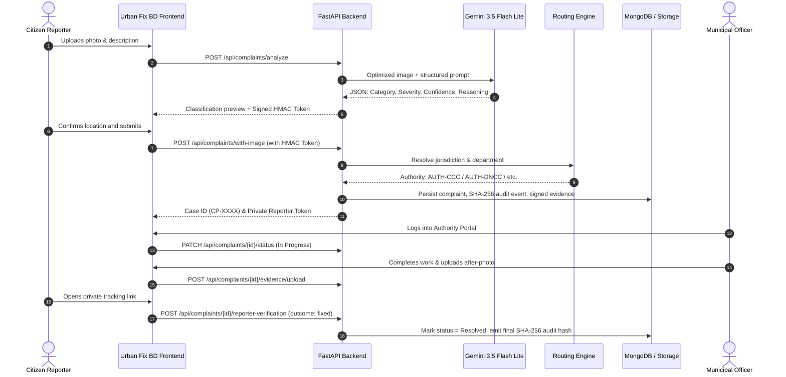
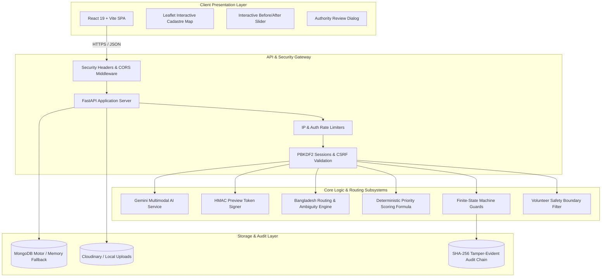
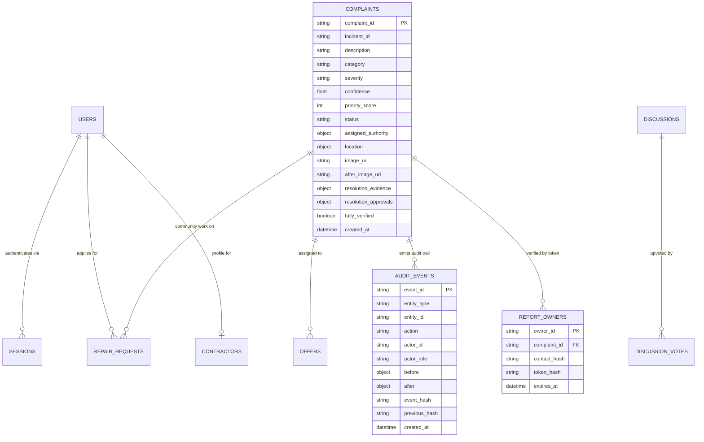

# Urban Fix BD

> **AI-Powered Civic Issue Reporting and Resolution Platform for Bangladesh**  
> *Transforming citizen reports and photographic evidence into prioritized, transparent, and verified municipal action.*

[](LICENSE)
[](https://fastapi.tiangolo.com)
[](https://react.dev)
[](https://vitejs.dev)
[](https://python.org)
[](https://ai.google.dev)
[](https://tailwindcss.com)
[](backend/tests)
[](render.yaml)

---

## Table of Contents

- [1. Project Overview](#1-project-overview)
- [2. Problem Statement](#2-problem-statement)
- [3. Our Solution](#3-our-solution)
- [4. Key Features](#4-key-features)
- [5. How It Works](#5-how-it-works)
- [6. AI Capabilities](#6-ai-capabilities)
- [7. System Architecture](#7-system-architecture)
- [8. Technology Stack](#8-technology-stack)
- [9. Project Structure](#9-project-structure)
- [10. Screenshots and Demo](#10-screenshots-and-demo)
- [11. Installation and Local Setup](#11-installation-and-local-setup)
- [12. Environment Variables](#12-environment-variables)
- [13. API Overview](#13-api-overview)
- [14. Database Overview](#14-database-overview)
- [15. Testing & Quality Assurance](#15-testing--quality-assurance)
- [16. Deployment](#16-deployment)
- [17. Security & Privacy](#17-security--privacy)
- [18. Current Limitations](#18-current-limitations)
- [19. Future Roadmap](#19-future-roadmap)
- [20. Contributors](#20-contributors)
- [21. License](#21-license)

---

## 1. Project Overview

**Urban Fix BD** is a civic technology platform engineered specifically for the municipal infrastructure and governance landscape of Bangladesh. It empowers citizens to report civic emergencies and infrastructure failures—such as asphalt craters, open manholes, hazardous garbage piles, water supply bursts, and drainage overflows—using photographic evidence and geolocation.

Rather than acting as a simple complaint log, Urban Fix BD employs a multimodal Artificial Intelligence triage engine powered by **Google Gemini (gemini-3.5-flash-lite)**, coupled with a deterministic geographic routing engine covering Bangladeshi City Corporations (CCC, DNCC, DSCC), regional WASAs, and national infrastructure agencies. The platform enforces a tamper-evident cryptographic audit chain, deterministic priority calculations, two-party verified resolution workflows, and volunteer safety guardrails.

---

## 2. Problem Statement

Urban centers across Bangladesh face severe civic maintenance bottlenecks:

1. **Unstructured & Unverified Citizen Reporting:** Municipal hotlines and social media groups receive thousands of ambiguous, duplicate, or unverified complaints lacking actionable coordinates and visual triage.
2. **Jurisdictional Fragmentation & Misrouting:** Overlapping responsibilities between City Corporations, Water Supply & Sewerage Authorities (WASAs), power distribution companies (BPDB/DESCO/DPDC), and national highway agencies (RHD) frequently cause complaints to stall indefinitely.
3. **Black-Box Triage & Lack of Transparency:** Citizens cannot track how priority is assigned, leading to loss of civic trust.
4. **"Ghost" Resolutions:** Work orders are frequently marked as "completed" in administrative ledgers without photographic verification from the field or confirmation from affected citizens.
5. **Safety Hazards for Community Volunteers:** Youth and volunteer groups attempting to resolve local issues without supervision risk electrocution from exposed wires, hazardous chemical exposure, or confined-space asphyxiation in sewer mains.

---

## 3. Our Solution

Urban Fix BD addresses these systemic bottlenecks with an end-to-end civic accountability loop:

```
[Citizen Photo & Location]
         │
         ▼
[Multimodal AI Intake & Triage] ────► [Signed HMAC Preview Token]
         │
         ▼
[Deterministic Bangladesh Routing Engine] (CCC / DNCC / DSCC / WASAs / Utilities)
         │
         ▼
[Deterministic Priority Score (0-100)] (Severity + Duplicates + Waiting Time + Impact + Safety)
         │
         ▼
[Multi-Role Operations Workspace] ────► [Contractors / Youth Micro-Maintenance]
         │
         ▼
[Two-Party Resolution Verification] (Before/After Photos + GPS + Citizen Token Confirmation)
         │
         ▼
[Cryptographic Tamper-Evident SHA-256 Audit Chain & Public Receipt]
```

---

## 4. Key Features

- **Multimodal AI Intake:** Uploaded photos are verified, sanitized, and classified via Google Gemini into standardized municipal categories and severity tiers.
- **Cryptographic Preview Tokens:** Intake endpoints issue HMAC-SHA256 tokens allowing citizens to preview AI triage and submit without duplicate AI inference overhead.
- **Deterministic Bangladesh Authority Routing:** Pure routing engine with geographic keyword matching and boundary checks for Chattogram City Corporation (CCC), Dhaka North (DNCC), Dhaka South (DSCC), CWASA, DWASA, BPDB, DESCO, DPDC, LGED, and RHD.
- **Ambiguity Detection Guards:** Prevents misrouting of national highways, underground sewerage, or power grids by routing ambiguous cases to human officer review.
- **Deterministic 0–100 Priority Scoring:** Objective, explainable priority calculated from severity weight, duplicate clustering, waiting age, location impact, and safety hazards.
- **Strict Finite-State Lifecycle Machine:** Enforces valid lifecycle progressions from `Submitted` to `Resolved`; prohibits premature or unverified closure.
- **Two-Party Resolution Verification:** Requires photographic completion evidence from field teams and explicit verification from the citizen reporter via private token.
- **Cryptographic SHA-256 Audit Chain:** Every status change, officer override, and work order approval emits an immutable audit event linked to prior hash pointers.
- **Public Accountability Receipts:** Citizens can view and verify an immutable receipt with a canonical SHA-256 digital fingerprint.
- **Volunteer Safety Barrier:** Automatically bars community youth volunteers from claiming hazardous assignments (high-voltage electrical, open gas, structural collapse).
- **Privacy & PII Scrubbing:** Automatically redacts Bangladeshi mobile phone numbers (`+880 1X...`), National Identity (NID) numbers, and emails; fuzzes public coordinates to ~110m accuracy.
- **Bilingual Interface:** Instant language switching between English (`EN`) and Bengali (`বাংলা`).

---

## 5. How It Works



---

## 6. AI Capabilities

### Multimodal Analysis Workflow
1. **Image Sanitization (`_optimize_image_for_ai`):**
   - Strips dangerous metadata and extracts permissible GPS suggestions.
   - Normalizes orientation via EXIF transposition.
   - Bounds maximum dimensions to 1600px using Lanczos resampling (never upscales).
   - Converts to clean JPEG (quality 85) to preserve inference performance while retaining visual detail.
2. **Model Configuration:**
   - **Model:** `gemini-3.5-flash-lite`
   - **Endpoint:** `https://generativelanguage.googleapis.com/v1beta/models/{model}:generateContent`
   - **Output Format:** Strict JSON schema validation via Pydantic (`StructuredAnalysis`).
3. **Structured Classification Output:**
   - `category`: Road Infrastructure, Waste Management, Water Supply, Drainage / Sewerage, Street Lighting, Public Infrastructure, Other.
   - `severity`: Critical, High, Medium, Low.
   - `confidence`: Float between 0.0 and 1.0.
   - `safety_flag`: Boolean for immediate hazards (open manholes, live wires, structural collapses).
   - `multi_issue_detected`: Boolean indicating compounding problems.
   - `is_civic_issue`: Binary filter rejecting non-civic media (selfies, documents, indoor photos).
   - `detected_language`: Language identification (English, Bengali).
   - `citizen_response`: Localized citizen acknowledgement message.
4. **Resilience & Fallback Heuristics (`_fallback_analysis`):**
   - Automatically activates if Gemini API key is unset, times out (>90s), or encounters network/rate limits.
   - Deterministic keyword rules analyze text hints, assign baseline severity, flag safety hazards, and mark `analysis_source="fallback-rules"` with `needs_review=True`.

---

## 7. System Architecture



---

## 8. Technology Stack

| Layer | Technology | Version | Purpose |
| :--- | :--- | :--- | :--- |
| **Frontend Core** | React | `19.2.8` | Declarative UI component tree |
| **Frontend Build** | Vite | `8.2.2` | Fast HMR development and asset bundling |
| **CSS & Design** | Tailwind CSS | `3.4.17` | Utility-first styling with dynamic CSS variables |
| **Icons** | Lucide React | `1.37.0` | Accessible SVG iconography |
| **Mapping** | Leaflet | `1.9.4` | Interactive public incident map |
| **Backend Core** | FastAPI | `0.115.6` | High-performance ASGI REST API framework |
| **ASGI Server** | Uvicorn | `0.34.0` | Production ASGI web server |
| **Validation** | Pydantic / Pydantic Settings | `2.10.4` | Strict request/response data validation |
| **Database** | MongoDB Motor / PyMongo | `3.6.0` / `4.9.2` | Async MongoDB driver with transactional rollback |
| **Image Processing** | Pillow (PIL) | `11.1.0` | Server-side image decoding, sanitization, EXIF transposition |
| **HTTP Client** | HTTPX | `0.28.1` | Async HTTP client for Gemini REST API calls |
| **AI Multimodal** | Google Gemini | `gemini-3.5-flash-lite` | Multimodal visual classification and reasoning |
| **Cloud Storage** | Cloudinary | `1.41.0` | Cloud-hosted evidence image hosting |
| **Testing (Backend)** | Pytest | `8.3.4` | Unit and integration test runner (120 tests) |
| **Testing (Frontend)** | Vitest & Playwright | `4.1.11` / `1.62.1` | Unit, integration, and E2E browser testing |

---

## 9. Project Structure

```text
urban-fix-bd/
├── backend/
│   ├── app/
│   │   ├── api/
│   │   │   └── routes/           # 15 Route modules (complaints, auth, authorities, dashboard, etc.)
│   │   ├── core/
│   │   │   ├── config.py         # Pydantic Settings & environment validation
│   │   │   └── security.py       # PBKDF2 hashing, cookie sessions, CSRF, RBAC
│   │   ├── db/
│   │   │   └── repository.py     # CivicRepository: Motor + in-memory fallback, demo seeder, indexes
│   │   ├── models/
│   │   │   └── constants.py      # Categories, severities, department mappings
│   │   ├── schemas/              # Pydantic request/response models
│   │   ├── services/
│   │   │   ├── accountability.py # SHA-256 tamper-evident receipt generator
│   │   │   ├── ai/gemini.py      # Image optimization, Gemini triage, fallback rules
│   │   │   ├── analytics/        # Calculation engine for metrics
│   │   │   ├── audit.py          # Append-only SHA-256 audit trail logger
│   │   │   ├── contractors/      # Contractor scoring, matching, offers
│   │   │   ├── lifecycle.py      # Finite-state machine transition guards
│   │   │   ├── priority.py       # Deterministic priority scoring algorithm
│   │   │   ├── privacy.py        # PII redaction (BD mobile, NID, email) & coordinate fuzzing
│   │   │   ├── reporter_access.py# Token-based citizen tracking and verification gate
│   │   │   ├── routing/          # Bangladesh City Corporations & Ministries routing engine
│   │   │   ├── storage/          # Cloudinary client & local file upload security
│   │   │   └── volunteer_safety.py# Safety barrier protecting community youth
│   │   └── main.py               # FastAPI application setup, CORS, security headers
│   ├── requirements.txt          # Python backend dependencies
│   ├── pytest.ini                # Pytest configuration
│   └── tests/                    # 11 Backend test suites (120 tests)
├── data/
│   ├── demo/                     # Demo fixtures: complaints.json, contractors.json
│   └── uploads/                  # Local upload directory for development
├── deploy/                       # Deployment notes and configurations
├── docs/                         # Technical documentation and architecture maps
├── public/                       # Favicon, logos, web manifest, service worker
├── src/                          # React 19 Frontend
│   ├── components/               # InteractiveBeforeAfter, ReviewDialog, Icon
│   ├── lib/                      # api.js fetch client with CSRF handling
│   ├── test/                     # Frontend test setup
│   ├── App.jsx                   # Single-Page App shell with 7 primary view tabs
│   ├── App.test.jsx              # Vitest test suite
│   ├── main.jsx                  # React DOM mount point
│   └── styles.css                # Tailwind base styles and theme variables
├── tests/
│   └── e2e/                      # Playwright end-to-end tests
├── Dockerfile                    # Multi-stage production container
├── render.yaml                   # Render deployment blueprint
├── vercel.json                   # Vercel SPA routing and proxy configuration
├── package.json                  # Frontend dependencies and npm scripts
└── tailwind.config.js            # Tailwind CSS configuration
```

---

## 10. Screenshots and Demo

| View | Description | Preview |
| :--- | :--- | :--- |
| **Citizen Intake Wizard** | Multimodal photo upload with AI triage preview | *[Add Screenshots: Citizen Intake]* |
| **Interactive Before/After** | Draggable slider comparing damaged vs. restored site | *[Add Screenshots: Before/After Slider]* |
| **Public Incident Map** | Geospatial cadastre map with status filtering | *[Add Screenshots: Public Map]* |
| **Authority Console** | Municipal officer dashboard with queue and review modal | *[Add Screenshots: Authority Console]* |
| **Accountability Receipt** | Cryptographic SHA-256 verification receipt | *[Add Screenshots: Accountability Receipt]* |

- **Live Demonstration:** `[Add Live Demo URL]`
- **Walkthrough Video:** `[Add Demo Video URL]`
- **Project Presentation Deck:** `[Add Presentation URL]`

---

## 11. Installation and Local Setup

### Prerequisites
- **Node.js:** v18.0.0 or higher (v20+ recommended)
- **Python:** v3.11, 3.12, or 3.13
- **MongoDB:** Local instance on `mongodb://localhost:27017` OR MongoDB Atlas connection string (or run in in-memory fallback mode)
- **Git**

### Step 1: Clone the Repository
```bash
git clone https://github.com/Arik09013/urban-fix-bd.git
cd urban-fix-bd
```

### Step 2: Backend Setup
```bash
# Navigate to backend directory
cd backend

# Create Python virtual environment
python -m venv .venv

# Activate virtual environment
# Windows (PowerShell):
.venv\Scripts\Activate.ps1
# Linux/macOS:
source .venv/bin/activate

# Install dependencies
pip install -r requirements.txt

# Configure environment variables
cp .env.example .env
# Edit .env with your GEMINI_API_KEY and other parameters

# Start FastAPI development server
python -m uvicorn app.main:app --reload --port 8000
```
Backend will be live at `http://127.0.0.1:8000`. Swagger API documentation: `http://127.0.0.1:8000/docs`.

### Step 3: Frontend Setup
```bash
# Open a new terminal in the project root
npm install

# Start Vite development server
npm run dev
```
Frontend will be accessible at `http://localhost:5173`. Vite proxies `/api` and `/uploads` requests directly to `http://127.0.0.1:8000`.
- **Live Technical Documentation & Pitch Deck**: `http://localhost:5173/docs`
- **Backend Swagger OpenAPI Explorer**: `http://127.0.0.1:8000/docs`

---

## 12. Environment Variables

Create a `backend/.env` file. Key configuration parameters:

| Variable | Default (Dev) | Required in Prod? | Description |
| :--- | :--- | :---: | :--- |
| `ENVIRONMENT` | `development` | Yes | Set to `production` on live servers. |
| `PUBLIC_BASE_URL` | `http://127.0.0.1:8000` | Yes | Canonical base URL for media and signed links. |
| `ADMIN_USERNAME` | `admin` | Yes | Superadministrator login username. |
| `ADMIN_PASSWORD` | `admin` | Yes (min 12 chars) | Superadministrator password (rotate in prod). |
| `ALLOW_DEMO_ADMIN` | `false` | No | When `true`, exposes demo admin shortcut credentials. |
| `ALLOW_DEMO_OFFICER_LOGIN` | `true` | No (must be `false` in prod) | Enables one-click simulated officer logins. |
| `DEMO_OFFICER_DEFAULT_PASSWORD`| `OfficerDemo123!` | No | Password for pre-seeded demo officers. |
| `REPORTER_TOKEN_SECRET` | `development-reporter-secret` | Yes (min 32 chars) | Secret used to sign HMAC preview and tracking tokens. |
| `EVIDENCE_SIGNING_SECRET` | `""` | Yes (min 32 chars) | HMAC secret for signed evidence media URLs. |
| `MONGO_URI` | `mongodb://localhost:27017` | Yes | MongoDB connection string (supports Atlas SRV). |
| `MONGO_DB_NAME` | `urbanfix` | No | Database name. |
| `ALLOW_MEMORY_FALLBACK` | `true` | No (auto-disabled in prod) | Enables in-memory dictionary mirror if DB fails. |
| `SEED_DEMO_DATA` | `true` | No | Seeds demo complaints and discussion posts on startup. |
| `GEMINI_API_KEY` | `""` | Optional | Google Gemini API key. If omitted, uses fallback rules. |
| `GEMINI_MODEL` | `gemini-3.5-flash-lite` | No | Gemini model identifier. |
| `GEMINI_TIMEOUT_SECONDS` | `60` | No | Request timeout for Gemini API calls. |
| `CLOUDINARY_CLOUD_NAME` | `""` | Yes in prod | Cloudinary cloud name for evidence storage. |
| `CLOUDINARY_API_KEY` | `""` | Yes in prod | Cloudinary API key. |
| `CLOUDINARY_API_SECRET` | `""` | Yes in prod | Cloudinary API secret. |
| `CORS_ORIGINS` | `["http://localhost:5173", ...]`| No | Allowed origins for browser CORS headers. |

---

## 13. API Overview

Base URL: `http://localhost:8000/api`

| Group | Method | Path | Auth / Role | Description |
| :--- | :--- | :--- | :--- | :--- |
| **System** | `GET` | `/health` | Public | Healthcheck and storage status |
| | `GET` | `/ready` | Public | Kubernetes/Container readiness probe |
| | `GET` | `/system-health` | Public | Deep subsystem diagnostic status |
| **Auth** | `POST` | `/auth/register` | Public (Rate-limited) | Register youth or contractor account |
| | `POST` | `/auth/login` | Public (Rate-limited) | Login; sets HTTP-only session cookie |
| | `POST` | `/auth/demo-officer-login`| Demo Only | Controlled demo officer login |
| | `GET` | `/auth/me` | Authenticated | Retrieve profile & CSRF token |
| | `POST` | `/auth/logout` | Authenticated | Invalidate active session |
| | `POST` | `/auth/officers` | Admin Only | Provision municipal officer account |
| **Complaints** | `POST` | `/complaints/analyze` | Public (Multipart) | Multimodal AI preview; returns HMAC token |
| | `GET` | `/complaints` | Public (Paginated) | Redacted complaint list |
| | `GET` | `/complaints/map` | Public | Bounding box spatial complaint query |
| | `GET` | `/complaints/map/clusters`| Public | Zoom-aware incident clustering |
| | `GET` | `/complaints/{id}` | Public | Full redacted complaint record |
| | `POST` | `/complaints/with-image`| Public (Multipart) | Intake with photo, metadata, preview token |
| | `PATCH`| `/complaints/{id}/status`| Officer / Admin | Finite-state machine transition |
| | `POST` | `/complaints/{id}/progress`| Officer / Admin | Append officer field progress note |
| | `POST` | `/complaints/{id}/affected-too`| Public (Spam-guarded) | "I am affected too" citizen signal |
| | `PATCH`| `/complaints/{id}/override`| Admin Only | Officer reclassification & routing override |
| | `POST` | `/complaints/{id}/evidence/upload`| Officer / Admin | Upload repair evidence photo |
| | `GET` | `/complaints/{id}/evidence/file/{kind}`| Auth / Token / Signed | Secure evidence image retrieval |
| | `POST` | `/complaints/{id}/reporter-verification`| Reporter Token | Citizen confirms or disputes resolution |
| | `POST` | `/complaints/{id}/resolution-approval`| Officer / Admin | Authority resolution approval sign-off |
| **Authorities**| `GET` | `/authorities` | Public | List registered candidate authorities |
| | `GET` | `/authorities/{id}` | Public | Detailed authority profile and departments |
| **Contractors**| `GET` | `/contractors` | Admin Only | Directory of registered contractors |
| | `GET` | `/contractors/match/{id}`| Admin Only | Ranked matches for a complaint |
| **Offers** | `GET` | `/offers` | Contractor / Admin | List work order offers |
| | `POST` | `/offers` | Admin Only | Dispatch offer to contractor |
| | `PATCH`| `/offers/{id}/status` | Contractor / Admin | Update offer status |
| | `POST` | `/offers/{id}/proof` | Assigned Contractor | Submit Google Drive report & after-photo |
| **Youth Work**| `GET` | `/repair-requests` | User (Scoped) | List community cleanup proposals |
| | `POST` | `/repair-requests` | Youth Account | Submit low-risk cleanup proposal |
| | `PATCH`| `/repair-requests/{id}/decision`| Admin Only | Approve/reject funding proposal |
| | `POST` | `/repair-requests/{id}/proof-with-image`| Youth / Admin | Submit completed cleanup evidence |
| | `POST` | `/repair-requests/{id}/release-funds`| Admin Only | Release reserved micro-grant funds |
| **Tracking** | `GET` | `/track/{id}` | Public / Token | Public incident timeline and SLA status |
| | `GET` | `/track/{id}/receipt` | Public | Cryptographic accountability receipt |
| **Operations**| `GET` | `/operations/queue` | Officer / Admin | Authority-scoped operational work queue |
| | `GET` | `/operations/incidents/{id}`| Officer / Admin | Incident workspace & risk assessment |

---

## 14. Database Overview

The platform uses 14 MongoDB collections with indexed query paths:



---

## 15. Testing & Quality Assurance

### Backend Automated Test Suite
Urban Fix BD includes a 120-test Pytest test suite covering routing, security, AI validation, and multi-step resolution workflows:

```bash
# Run complete backend test suite
cd backend
.venv\Scripts\python.exe -m pytest tests
```
**Results:** `120 passed, 1 warning (100% pass rate)` across 11 test modules:
- `test_ai_validation.py` (19 tests): Gemini parsing, schema enforcement, fallback logic.
- `test_authority_routing.py` (21 tests): CCC, DNCC, DSCC, WASA routing, polygon ray-casting, boundary conflict rules.
- `test_officer_resolution_workflow.py` (15 tests): End-to-end multi-party verification and status transitions.
- `test_officer_security.py` (10 tests): RBAC, session expiry, authority isolation, CSRF validation.
- `test_phase3b_hardening.py` (12 tests): Upload headers, malicious payloads, rate limiters.
- `test_phase6_production_remediation.py` (12 tests): Idempotency key arbitration, signed URL security.
- `test_api.py`, `test_hardening.py`, `test_image_pipeline.py`, `test_storage.py`, `test_workflow.py`.

### Frontend Build & Test Verification
```bash
# Run frontend unit tests
npm test -- --run

# Run frontend production build
npm run build
```
- **Vite Production Build:** Successfully builds production bundle to `dist/` in ~8.7s with gzip compression.

---

## 16. Deployment

### Containerization (Docker)
The multi-stage `Dockerfile` compiles the React 19 frontend and packages the FastAPI backend into a production container:

```bash
# Build Docker container
docker build -t urban-fix-bd:latest .

# Run container locally
docker run -p 8000:8000 --env-file backend/.env urban-fix-bd:latest
```

### Production Hosting Architecture
- **Backend API & Processing:** Deployable to **Render** via `render.yaml` (Python 3.11 environment with Uvicorn worker process).
- **Frontend SPA:** Deployable to **Vercel** via `vercel.json` with SPA routing and API reverse proxy rules.
- **Database:** MongoDB Atlas (M0/M10+ cluster) with replica sets enabled for transactions.
- **Media Assets:** Cloudinary CDN for persistent evidence storage.

---

## 17. Security & Privacy

1. **Authentication:** PBKDF2 HMAC-SHA256 (310,000 rounds) password storage; cryptographically random 48-byte session tokens stored as SHA-256 hashes.
2. **CSRF Protection:** State-changing requests (`POST`, `PATCH`, `DELETE`) require an `X-CSRF-Token` header validated using constant-time comparison (`hmac.compare_digest`).
3. **Session Cookies:** `urbanfix_session` cookie configured with `HttpOnly`, `SameSite=Lax`, and `Secure` (in production).
4. **Media Sanitization:** Pillow decodes, strips EXIF metadata, resamples, and re-encodes all image uploads to prevent polyglot payloads and image-based exploits.
5. **PII Protection:** Server-side regular expressions redact Bangladeshi phone numbers, National Identity (NID) numbers, and email addresses from all public endpoints.
6. **Geospatial Privacy:** Public endpoints round GPS latitude and longitude to 3 decimal places (~110 meters), preventing disclosure of exact residential coordinates.
7. **Rate Limiting:** IP-level sliding-window rate limiters restrict citizen intake (max 20 per 10 minutes) and authentication attempts (max 10 per 5 minutes).

---

## 18. Current Limitations

- **Coarse Geographic Polygons:** Candidate authority jurisdictions currently use bounding boxes and area keyword heuristics. High-precision GIS polygon boundary shapefiles for all 41 Chattogram wards and 129 Dhaka wards require integration with official government open data.
- **MFS Payment Rails Simulated:** Community micro-grant disbursements currently operate via demo and Stripe sandbox rails; direct integration with local Bangladeshi Mobile Financial Services (bKash, Nagad, Rocket) is modeled in schema but awaits commercial API gateway keys.
- **Single-Model Multimodal AI:** Multimodal triage is tied to Google Gemini REST endpoints. An offline local vision model (e.g., quantized ONNX or Ollama) is not yet bundled for air-gapped environments.

---

## 19. Future Roadmap

- [ ] **Phase 1: Official GIS Ward Boundary Ingestion:** Ingest gazetted GeoJSON boundary files for CCC, DNCC, and DSCC to achieve sub-ward routing precision.
- [ ] **Phase 2: MFS Gateway Integration:** Integrate direct bKash and Nagad payout disbursement APIs for youth community micro-grants.
- [ ] **Phase 3: Native Mobile Applications:** Package responsive React SPA into Flutter / React Native wrappers with offline caching and camera capture.
- [ ] **Phase 4: Low-Bandwidth USSD / SMS Intake:** Implement a lightweight SMS/USSD intake gateway for citizens in areas without smartphone or high-speed data coverage.
- [ ] **Phase 5: Automated Satellite & Drone Imagery Verification:** Compare satellite or municipality drone imagery before and after road construction projects.

---

## 20. Contributors

Developed and maintained by the **Urban Fix BD** Engineering Team:

- **Lead Architect & Maintainer:** [@Arik09013](https://github.com/Arik09013)
- **Contributors & Reviewers:** `[Add Contributor Information]`
- **Inquiries & Civic Partnerships:** `[Add Contact Information]`

---

## 21. License

This project is licensed under the **MIT License**. See the [LICENSE](LICENSE) file for complete details.
