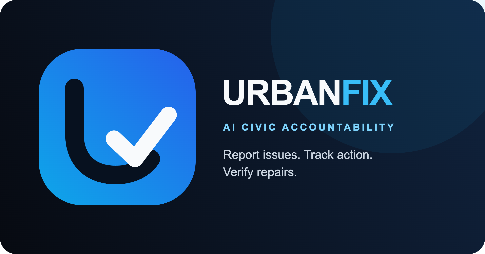

# Urban Fix BD



**Turn citizen evidence and municipal reporting into prioritized, transparent civic action across Bangladesh.**

Target Repository: [https://github.com/Arik09013/urban-fix-bd](https://github.com/Arik09013/urban-fix-bd)

---

## Open Source Lineage & Attribution

> [!IMPORTANT]
> **Upstream Project Attribution:**
> **Urban Fix BD** is an open-source civic technology platform adapted from [UrbanFix AI / CivicPulse](https://github.com/asadali552/CivicPulse), originally designed and built by [@asadali552](https://github.com/asadali552).
> 
> The core architectural patterns—including multimodal AI triage preview, explainable deterministic priority scoring, cryptographic tamper-evident accountability receipts, and contractor proof verification—are based on the original work licensed under the [MIT License](LICENSE).
> 
> This repository represents a dedicated **Bangladesh-focused fork and adaptation** maintained by [@Arik09013](https://github.com/Arik09013).

---

## Core Capabilities (Implemented & Verified)

The platform provides a functional decision-support and workflow engine for municipal problem remediation:

- **Multimodal AI Intake & Verification:** Citizens submit a photo and description. Multimodal AI (Google Gemini) generates an initial classification (category, severity, reasoning, safety flag), returned with a cryptographically signed HMAC preview token to prevent redundant inference costs.
- **Explainable Priority Scoring:** Prioritization is strictly deterministic, combining severity weights, repeat reports, citizen signals ("I am affected too"), waiting time, and location impact into an auditable score ($0$ to $100$).
- **Tamper-Evident Audit Chain:** Every status change, officer override, and work order approval logs a canonical SHA-256 hash pointer linked to prior events, generating a verifiable public accountability receipt.
- **Proof-Based Resolution:** Work cannot be marked resolved without photographic evidence and explicit verification. Two-party verification (authority + contractor/reporter) guards against premature closure.
- **Safety by Design:** EXIF stripping on uploaded photos, PII redaction for phone/email/national IDs, and volunteer safety boundary filters that prevent community claims on dangerous infrastructure (e.g. high-voltage wires, gas leaks, structural collapse).
- **Zero-Dependency In-Memory Fallback:** Built-in memory fallback allows local development, testing, and demonstrations without a running MongoDB cluster.

---

## Bangladesh Adaptation Roadmap: Implemented vs. Planned

To maintain strict engineering transparency, below is the exact status of our regional adaptations:

### Current Base Capabilities (Inherited from Upstream)
- [x] Full-stack FastAPI + React 19 / Vite single-page application.
- [x] Multimodal image & text triage via Gemini REST API with deterministic keyword fallback.
- [x] Finite-state lifecycle machine enforcing strict transition rules.
- [x] Automated unit and integration test suite (25 backend pytest cases, 5 frontend Vitest cases).
- [x] Dual-mode storage (MongoDB Motor with transactional rollback / in-memory demo dictionary).

### Planned Bangladesh Localization (In Progress / Future Work)
- [ ] **Bilingual Language Model Triage:** Adding native Bengali (`বাংলা`) text prompts and fine-tuned handling for colloquial Banglish municipal terminology.
- [ ] **City Corporation & Municipal Jurisdictions:** Adapting department routing tables for Bangladeshi administrative structures (Dhaka North City Corporation - DNCC, Dhaka South City Corporation - DSCC, Chattogram City Corporation - CCC, Rajshahi, Khulna, Sylhet, Barishal, Rangpur, and ward-level councils).
- [ ] **Local Privacy & Identification Scrubbing:** Customizing regex PII filters for Bangladeshi mobile numbers (`+880 1X...`) and National Identity (NID / Smart Card) number formats (`10`, `13`, or `17` digits).
- [ ] **Bangladeshi Geocoding & Bounding Boxes:** Pre-tuning map bounds, district clusters, and OpenStreetMap Nominatim reverse geocoding for Dhaka, Chattogram, and regional metropolitan areas.
- [ ] **Local Digital Disbursement Rails:** Evaluating bKash / Nagad merchant disbursement APIs alongside Stripe for community micro-maintenance stipends.

---

## Architecture

```text
React 19 + Vite client (Leaflet, Tailwind CSS)
        │ same-origin /api
        ▼
FastAPI application ── Gemini Multimodal Triage
        │              Cloudinary Evidence Storage
        │              Stripe / Local Payment Integrations
        ▼
MongoDB Motor Repository (with automatic In-Memory Demo Fallback)
```

---

## Getting Started (Local Development)

### Prerequisites
- Node.js 22+ (tested on Node.js 24)
- Python 3.11+
- Git

### Quick Setup

1. **Clone the repository:**
   ```bash
   git clone https://github.com/Arik09013/urban-fix-bd.git
   cd urban-fix-bd
   ```

2. **Frontend installation & build:**
   ```bash
   npm ci
   npm run build
   ```

3. **Backend installation:**
   ```bash
   python -m venv backend/.venv
   # Windows PowerShell:
   .\backend\.venv\Scripts\pip install -r backend/requirements.txt
   # Linux/macOS:
   ./backend/.venv/bin/pip install -r backend/requirements.txt

   # Create local configuration:
   cp backend/.env.example backend/.env
   ```

4. **Run the application:**
   ```bash
   # Windows PowerShell:
   .\backend\.venv\Scripts\python.exe -m uvicorn app.main:app --reload --port 8000 --app-dir backend
   # Linux/macOS:
   ./backend/.venv/bin/python -m uvicorn app.main:app --reload --port 8000 --app-dir backend
   ```
   Open <http://127.0.0.1:8000> in your browser.

---

## Verification & Test Suite

Verify system integrity with automated tests:

```bash
# Frontend unit tests
npm test

# Frontend production build
npm run build

# Backend test suite (25 tests)
backend/.venv/bin/pytest -q backend/tests
```

---

## License & Credits

- **Original Project:** [UrbanFix AI / CivicPulse](https://github.com/asadali552/CivicPulse) by [@asadali552](https://github.com/asadali552).
- **Bangladesh Adaptation:** Maintained by [@Arik09013](https://github.com/Arik09013).
- **License:** Released under the [MIT License](LICENSE).
