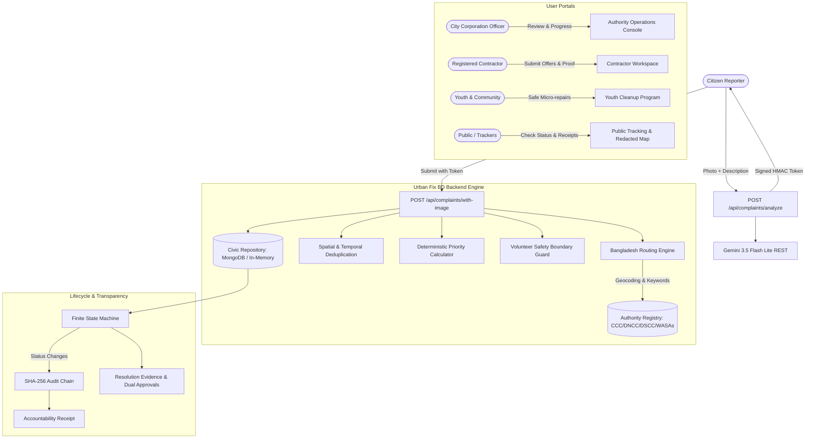

# Urban Fix BD — Project Master Context & Agent Handbook

> **Document Purpose:** This document is the single source of truth for the **Urban Fix BD** project. Any AI agent or developer joining the project can review this file to understand the architecture, data models, domain logic, runtime configurations, test suites, known quirks, and active development state without prior knowledge.

---

## 1. Project Overview & Attribution

### 1.1 Identity & Mission
**Urban Fix BD** is a civic technology platform adapted for Bangladesh that transforms citizen reports and photographic evidence into prioritized, transparent, and verified municipal action.

- **Primary Repository:** `https://github.com/Arik09013/urban-fix-bd`
- **Current Working Branch:** `feature/ui-update` (tracking `origin/feature/ui-update`)
- **Active Development Phase:** Redesigning UI with neo-brutalist civic cadastre aesthetic, default dark mode focus, and breathable navigation.
- **License:** MIT License
- **Target Deployment:** Fast-response civic remediation across Bangladeshi metropolitan jurisdictions (Chattogram City Corporation - CCC, Dhaka North City Corporation - DNCC, Dhaka South City Corporation - DSCC, and regional utilities).

### 1.2 Lineage & Upstream Attribution
- **Upstream Origin:** Adapted from **UrbanFix AI / CivicPulse** by [@asadali552](https://github.com/asadali552).
- **Regional Maintainer:** [@Arik09013](https://github.com/Arik09013).
- **Core Principles Inherited & Expanded:**
  1. **Multimodal AI Intake:** Multimodal image & text triage via Google Gemini with deterministic fallback heuristics.
  2. **Cryptographic Preview Tokens:** Signed HMAC tokens prevent duplicate AI inference costs during citizen intake.
  3. **Deterministic Priority Scoring:** Objective, explainable $0-100$ priority score computed from severity, duplicate density, waiting time, location impact, and safety risks.
  4. **Finite-State Lifecycle Machine:** Strict transitions preventing impossible or unverified closure states.
  5. **Two-Party Verified Resolution:** Work cannot be marked resolved without photographic evidence and explicit municipal verification.
  6. **Cryptographic Tamper-Evident Audit Chain:** Every status change and officer override emits a SHA-256 hash pointer linked to prior events.
  7. **Volunteer Safety Boundaries:** Strict rules blocking youth/community volunteers from claiming hazardous infrastructure (high-voltage electrical, open gas, structural collapse).
  8. **Dual-Mode Persistence:** MongoDB Motor with transactional rollback and zero-dependency in-memory dictionary fallback.

---

## 2. Tech Stack & Directory Structure

### 2.1 Technology Stack
| Layer | Technologies | Key Packages / Versions |
| :--- | :--- | :--- |
| **Frontend** | React 19, Vite 8, Tailwind CSS 3 | `react@19.2.8`, `leaflet@1.9.4`, `lucide-react@1.37.0`, `tailwindcss@3.4.17`, `vite@^8.2.2` |
| **Frontend Testing** | Vitest, Testing Library, Playwright | `vitest@4.1.11`, `jsdom@30.0.1`, `@playwright/test@1.62.1`, `@testing-library/react@16.3.3` |
| **Backend** | Python 3.11–3.13, FastAPI, Uvicorn | `fastapi==0.115.11`, `uvicorn==0.34.0`, `pydantic==2.10.6`, `httpx==0.28.1`, `pillow==11.1.0` |
| **Database** | MongoDB Motor / In-Memory Fallback | `motor==3.7.0`, `pymongo==4.11.2` (with full in-memory dictionary mirror) |
| **Storage** | Cloudinary / Local Uploads | `cloudinary==1.42.2`, local filesystem fallback with file magic validation |
| **AI / Multimodal** | Google Gemini REST API | Model: `gemini-3.5-flash-lite` via `https://generativelanguage.googleapis.com` |
| **Deployment / CI** | Docker, Render, Vercel, GitHub Actions | `render.yaml` (FastAPI backend), `vercel.json` (Vite SPA + rewrites), `.github/workflows/ci.yml` |

### 2.2 Directory Map
```text
urban-fix-bd/
├── backend/
│   ├── app/
│   │   ├── api/
│   │   │   └── routes/           # 15 Route modules (complaints, auth, authorities, dashboard, etc.)
│   │   ├── core/
│   │   │   ├── config.py         # Settings & environment validation via Pydantic
│   │   │   └── security.py       # PBKDF2 hashing, cookie sessions, CSRF, RBAC dependencies
│   │   ├── db/
│   │   │   └── repository.py     # CivicRepository: Motor + in-memory fallback, demo seeder, indexes
│   │   ├── models/
│   │   │   └── constants.py      # Standard categories, severities, department mappings
│   │   ├── schemas/              # Pydantic request/response schemas (complaint, contractor, offer)
│   │   ├── services/
│   │   │   ├── accountability.py # SHA-256 tamper-evident receipt generator
│   │   │   ├── ai/gemini.py      # Image optimization, Gemini multimodal triage, fallback rules
│   │   │   ├── analytics/        # Calculation engine for dashboard metrics
│   │   │   ├── audit.py          # Append-only audit trail logging
│   │   │   ├── contractors/      # Contractor scoring, matching, and offers
│   │   │   ├── lifecycle.py      # Finite-state machine transition guards
│   │   │   ├── priority.py       # Deterministic priority scoring algorithm
│   │   │   ├── privacy.py        # PII redaction (BD mobile, NID, email) & coordinate rounding
│   │   │   ├── reporter_access.py# Token-based citizen tracking and verification gate
│   │   │   ├── routing/          # Bangladesh City Corporations & Ministries routing engine
│   │   │   │   ├── engine.py     # Deterministic routing resolution & ambiguity detection
│   │   │   │   ├── jurisdiction.py# Geographical keywords (CCC, DNCC, DSCC) & bounding checks
│   │   │   │   └── registry.py   # Authority registry (CCC, DNCC, DSCC, CWASA, DWASA, BPDB, etc.)
│   │   │   ├── storage/          # Cloudinary client & local file upload security
│   │   │   └── volunteer_safety.py# Safety barrier protecting community youth from hazardous sites
│   │   └── main.py               # FastAPI application setup, CORS, security headers, upload routes
│   ├── requirements.txt          # Python dependencies
│   ├── pytest.ini                # Pytest configuration
│   ├── scripts/                  # Backend diagnostic tools (verify_live_gemini.py)
│   └── tests/                    # 10 Pytest test suites (114 test cases)
├── data/
│   ├── demo/                     # Demo fixtures: complaints.json, contractors.json
│   └── uploads/                  # Local upload directory for development
├── deploy/                       # Deployment guides (Render, Railway, Docker)
├── docs/
│   ├── API_CONTRACT.md           # API specification and contract notes
│   ├── DEMO_SCRIPT.md            # Interactive walkthrough guide
│   ├── ENGINEERING_REVIEW.md     # P0-P4 engineering review and architectural decisions
│   └── PROJECT_STRUCTURE.md      # High-level architecture map
├── public/                       # Favicon, logos, web manifest, service worker
├── src/                          # React 19 Frontend
│   ├── components/               # InteractiveBeforeAfter, ReviewDialog, Icon
│   ├── lib/                      # api.js fetch client with CSRF handling
│   ├── test/                     # Frontend test setup (setup.js)
│   ├── App.jsx                   # Single-Page App shell with 7 primary view tabs
│   ├── App.test.jsx              # Vitest test suite for report flows and normalization
│   ├── main.jsx                  # React DOM mount point
│   └── styles.css                # Tailwind base styles and custom theme variables
├── tests/
│   └── e2e/                      # Playwright end-to-end tests (responsive.spec.js)
├── index.html                    # Frontend HTML document with social meta tags
├── package.json                  # NPM dependencies and scripts
├── tailwind.config.js            # Tailwind configuration
├── vite.config.js                # Vite build, proxy, and Vitest configuration
├── render.yaml                   # Render deployment blueprint
├── vercel.json                   # Vercel SPA routing and backend proxy rewrites
└── Dockerfile                    # Containerization for FastAPI + static dist build
```

### 2.3 Frontend Design System: Neo-Brutalist Cadastre & Dark Mode
The frontend is undergoing a high-contrast civic cadastre redesign inspired by municipal ledgers and neo-brutalism:
- **Default Theme:** Dark mode is the primary default theme (`<html class="dark">` with automatic fallback to dark unless explicitly set to light in `localStorage`).
- **Dynamic CSS Variable Pipeline:** All theme tokens in `tailwind.config.js` map directly to CSS variables defined in `src/styles.css`, eliminating hardcoded hex color clashes:
  | Token | Light Mode (`:root`) | Dark Mode (`.dark`) | Usage |
  | :--- | :--- | :--- | :--- |
  | `--surface` | `#FCF9F2` (cream canvas) | `#0B0F17` (deep obsidian) | Primary application background |
  | `--surface-clean` | `#FFFFFF` (white card) | `#111827` (card obsidian) | Cards, inputs, dialogs |
  | `--surface-container` | `#F1EEE7` | `#15223A` (slate navy) | Secondary cards, pill badges |
  | `--border-black` | `#0B0C0E` (ink black) | `#334155` (high-contrast slate) | Structural 2px brutalist borders |
  | `--shadow-color` | `#0B0C0E` (solid black) | `#000000` (deep shadow) | Hard brutalist box-shadow offsets |
  | `--ink-primary` | `#0B0C0E` (charcoal) | `#F8FAFC` (pure crisp white) | Headings, labels, primary text |
  | `--ink-secondary` | `#4A4D53` (dark gray) | `#94A3B8` (slate text) | Subtitles, body descriptions |
  | `--primary-container`| `#00A3C4` (electric cyan) | `#00A3C4` (electric cyan) | Action buttons, active tabs |
  | `--on-primary-container`| `#00333F` (dark cyan) | `#070A11` (dark obsidian) | Text inside active primary badges |
- **Typography:** Dual-font pairing:
  - **Headings & Body:** `Inter` (weights 400, 600, 700, 800, 900) via `font-headline` / `font-sans`.
  - **Cadastre Data & Metadata:** `JetBrains Mono` via `font-mono` / `font-code` for tickers, statuses, IDs, and timestamps.
- **Top Header & Navigation Architecture:**
  - **Breathable & Uncluttered:** Strictly 4 core citizen navigation tabs (`Home`, `Report Issue`, `Track Report`, `Public Map`) with spacious padding (`px-4 sm:px-8 py-3.5`), text-only uppercase labels, and generous gap spacing (`gap-6`).
  - **Strict No-Clutter Policy:** No auxiliary marketing tabs or phone numbers in the top bar (e.g., `Community` and `Civic Hotline` are kept out of the main navbar to adhere strictly to the original cadastre specification).
  - **Control Cluster:** Top right houses the system theme toggle (`sun`/`moon`) and the direct `Authority Portal` launcher.
  - **Top Cadastre Ticker Ribbon:** Persistent telemetry ticker (`DISPATCH STATUS: ACTIVE`, `NO APP DOWNLOAD REQUIRED`, `AVERAGE VERIFICATION TIME: 4.2 HRS`, `CURRENT INCIDENT LOAD`).

---

## 3. Core Domain Subsystems & Architecture



### 3.1 Multimodal Intake & Cryptographic Preview
- **Route:** `POST /api/complaints/analyze`
- **Mechanism:**
  - Citizen uploads image + text hint.
  - Image is bounded to maximum $1600\text{px}$ dimension, converted to clean JPEG, and EXIF orientation is transposed while stripping metadata (`_optimize_image_for_ai`).
  - Calls Gemini REST API (`gemini-3.5-flash-lite`) returning structured classification: category, severity, confidence, reasoning, summary, safety flags, and detected language.
  - Generates an HMAC-SHA256 signed `analysis_token` (valid for 15 minutes) using `EVIDENCE_SIGNING_SECRET`.
  - When the user confirms and calls `POST /api/complaints/with-image`, the server verifies the token signature and reuses the previewed analysis without incurring duplicate Gemini inference cost.
  - If Gemini fails or times out, the system automatically falls back to deterministic keyword rules (`_fallback_analysis`) with `analysis_source="fallback-rules"` and flags `needs_review=True`.

### 3.2 Bangladesh Jurisdiction & Routing Engine
- **Files:** `backend/app/services/routing/{engine.py, jurisdiction.py, registry.py}`
- **Coverage:**
  - **City Corporations:** Chattogram City Corporation (`AUTH-CCC`), Dhaka North City Corporation (`AUTH-DNCC`), Dhaka South City Corporation (`AUTH-DSCC`).
  - **Utilities & Specialized Agencies:** Chattogram WASA (`AUTH-CWASA`), Dhaka WASA (`AUTH-DWASA`), DPHE (`AUTH-DPHE`), BPDB (`AUTH-BPDB`), DESCO (`AUTH-DESCO`), DPDC (`AUTH-DPDC`), LGED (`AUTH-LGED`), Roads and Highways Department (`AUTH-RHD`).
- **Deterministic Rules & Ambiguity Guard:**
  - Detects institutional ambiguity before misrouting:
    - National highways / port connecting roads $\rightarrow$ RHD / Port Authority flags.
    - Underground sewerage vs. surface drainage $\rightarrow$ WASA vs. City Corporation flags.
    - High-voltage power grid vs. street lamps $\rightarrow$ BPDB/DESCO vs. City Corporation electrical division.
  - If jurisdiction is outside known boundaries or ambiguous, status becomes `needs_review` and `review_type="routing_uncertain"`, requiring administrative intervention rather than guessing.
  - Candidate authorities carry `data_status="pending_verification"` in adherence to civic data integrity.

### 3.3 Finite-State Lifecycle Machine
- **File:** `backend/app/services/lifecycle.py`
- **Statuses:**
  `Submitted` $\rightarrow$ `Needs Review` $\rightarrow$ `Assigned` $\rightarrow$ `Contractor Offer Sent` $\rightarrow$ `Acknowledged` $\rightarrow$ `In Progress` $\rightarrow$ `Resolution Submitted` $\rightarrow$ `Evidence Uploaded` $\rightarrow$ `Verification` $\rightarrow$ `Resolved` (or `Rejected` / `Reopened - Needs Review`).
- **Transition Invariants:**
  - Direct jump from `Submitted` to `Resolved` is strictly rejected (`HTTP 400/409`).
  - Cannot acknowledge a complaint with unverified authority routing.
  - Moving to `Evidence Uploaded`, `Verification`, or `Resolved` requires valid `resolution_evidence`.
  - Final resolution requires `fully_verified=True` (contractor/officer resolution evidence + authority verification approval).

### 3.4 Deterministic Priority Scoring Formula
- **File:** `backend/app/services/priority.py`
- Priority score ($0-100$) is computed strictly deterministically:
  $$\text{Score} = \min(100, W_{\text{severity}} + P_{\text{duplicates}} + P_{\text{waiting}} + P_{\text{impact}} + P_{\text{safety}})$$
  - **Severity Weight ($W_{\text{severity}}$):** Critical = $40$, High = $32$, Medium = $24$, Low = $16$.
  - **Duplicates & Affected ($P_{\text{duplicates}}$):** Up to $22$ points based on duplicate clusters and "Affected Too" citizen signals.
  - **Waiting Age ($P_{\text{waiting}}$):** $\min(\lfloor \text{hours} / 8 \rfloor, 12)$ points.
  - **Location Impact ($P_{\text{impact}}$):** Up to $20$ points (proximity to schools, hospitals, arterial transit).
  - **Critical Safety ($P_{\text{safety}}$):** $12$ points if safety risk flag is raised.
- Non-mutating calculation (`with_current_priority`) dynamically updates the age component during tracking without corrupting database records.

### 3.5 Tamper-Evident SHA-256 Audit Trail
- **Files:** `backend/app/services/accountability.py`, `backend/app/services/audit.py`
- Each state transition, officer reclassification, and work order approval creates an append-only audit event in `audit_events`.
- Events store `event_hash = sha256(event_payload)` and `previous_hash`, forming an unbroken cryptographic hash chain.
- The public accountability receipt generates a top-level `receipt_hash` providing verifiable proof against administrative tampering.

### 3.6 Privacy, Redaction & Coordinates
- **File:** `backend/app/services/privacy.py`
- **PII Scrubbing:** Automatically scrubs phone numbers (`+880 1X...` and Pakistani test patterns), Bangladeshi National Identity Card numbers (NID: 10, 13, 17 digits), and emails.
- **Coordinate Fuzzing:** Public API rounds latitude and longitude to 3 decimal places (~$110\text{m}$ accuracy) to protect reporter privacy.
- **Private Fields Denylist:** Strips `reporter_name`, `reporter_contact`, `source_fingerprint`, `affected_sources`, `internal_notes`, `private_metadata`, and `location_geo`.

### 3.7 Volunteer Safety Boundaries
- **File:** `backend/app/services/volunteer_safety.py`
- Blocks youth and community groups from claiming work orders for hazardous municipal issues:
  - High-voltage electrical wiring, transformer sparks, open power boxes.
  - Gas leaks, fuel spills, chemical fumes.
  - Structural collapse, deep sinkholes, unbarricaded manholes.
  - Fast-moving highway arterial repairs.

---

## 4. API Endpoints Catalog

Base URL: `http://localhost:8000/api`

| Group | Method & Path | Description & Access Control |
| :--- | :--- | :--- |
| **System** | `GET /health` | Healthcheck (checks Mongo connectivity & environment) |
| | `GET /ready` | Readiness probe for container orchestration |
| **Authentication** | `POST /auth/register` | Register youth or contractor account (Rate-limited: 10 req/5 min) |
| | `POST /auth/login` | Login with email/password; returns HTTP-only session cookie |
| | `POST /auth/demo-officer-login` | Instant demo login for verified officers (controlled by `ALLOW_DEMO_OFFICER_LOGIN`) |
| | `GET /auth/me` | Fetch authenticated user profile & CSRF token |
| | `POST /auth/logout` | Invalidate active session |
| | `POST /auth/officers` | Admin-only creation of municipal officer accounts |
| **Complaints** | `POST /complaints/analyze` | Multimodal AI preview analysis; returns signed HMAC preview token |
| | `GET /complaints` | Public complaints list (paginated, privacy-redacted) |
| | `GET /complaints/map` | Compact coordinates and status for public Leaflet map |
| | `GET /complaints/map/clusters` | Server-side zoom-aware spatial clustering (max 2,000 clusters) |
| | `GET /complaints/{id}` | Detailed complaint; includes audit history, SLA, and receipt |
| | `POST /complaints/with-image` | Full complaint intake with uploaded photo and preview token |
| | `PATCH /complaints/{id}/status` | Lifecycle status transition (Officer/Admin only) |
| | `POST /complaints/{id}/progress` | Add progress note (Officer/Admin only) |
| | `POST /complaints/{id}/affected-too` | Public citizen "I am affected too" endorsement |
| | `PATCH /complaints/{id}/override` | Officer reclassification of category/severity with mandatory reason |
| | `POST /complaints/{id}/evidence/upload` | Upload before/after repair evidence (Officer/Contractor) |
| | `GET /complaints/{id}/evidence/file/{kind}` | Secure evidence viewing with token or officer authorization |
| | `POST /complaints/{id}/citizen-verification` | Reporter confirmation or dispute using secret access token |
| | `POST /complaints/{id}/resolution-approval` | Authority sign-off approving contractor/officer resolution |
| **Authorities** | `GET /authorities` | List all registered candidate authorities & operational statuses |
| | `GET /authorities/{id}` | Detailed authority specifications and departments |
| **Contractors & Offers** | `GET /contractors` | Contractor directory |
| | `POST /contractors` | Contractor self-registration |
| | `GET /contractors/match/{complaint_id}` | Ranked contractor matches based on skills, trust score, proximity |
| | `GET /offers` | List work order offers |
| | `POST /offers` | Dispatch offer to contractor |
| | `PATCH /offers/{id}/status` | Accept, reject, or complete contractor offer |
| **Community Repairs** | `GET /repair-requests` | List youth micro-repair proposals |
| | `POST /repair-requests` | Submit youth repair proposal (guarded by Volunteer Safety Filter) |
| | `PATCH /repair-requests/{id}/decision` | Approve/reject funding request |
| | `POST /repair-requests/{id}/proof` | Submit youth cleanup proof |
| | `POST /repair-requests/{id}/release-funds` | Authority fund disbursement release |
| **Operations & Tracking** | `GET /operations/incidents/{id}` | Consolidated incident deep dive for municipal dispatch |
| | `GET /track/{id}` | Public tracking view with timeline and accountability receipt |
| | `GET /dashboard` | High-level municipal metrics and breakdown |
| | `GET /analytics/dashboard` | Department performance, SLA compliance, resolution stats |
| | `GET /discussions` | Public citizen comments and upvotes on complaints |
| | `GET /geo/reverse` | Reverse geocoding proxy with local caching |
| | `POST /whatsapp/webhook` | Production WhatsApp intake webhook with HMAC verification |

---

## 5. Frontend Architecture & UI Views

The frontend is a React 19 single-page application (`src/App.jsx`) with no external heavy UI frameworks, using Tailwind CSS and Lucide icons.

### 5.1 Primary Navigation Tabs (`activeTab`)
1. **`landing`**:
   - Hero header with civic action value proposition.
   - Live metrics summary: Total Reports, Resolved, Under Review, Active Repairs.
   - **`InteractiveBeforeAfter`** component: draggable slider comparing raw civic issue vs. completed repair.
   - Methodology breakdown & featured verified repairs.
2. **`report`**:
   - Multi-step citizen intake wizard:
     - Step 1: Upload photo evidence.
     - Step 2: Trigger AI multimodal preview (Gemini); displays category, severity, confidence, reasoning.
     - Step 3: Location detection (GPS / map pin / reverse geocoded area) and optional contact info.
     - Step 4: Submission confirmation with generated Case ID (`CP-...`) and personal tracking token.
3. **`track`**:
   - Citizen lookup by Case ID.
   - Complete status timeline, SLA indicators, and verified officer progress notes.
   - Cryptographic accountability receipt viewer.
   - **Citizen Verification Gate:** Allows the original reporter (via access token) to officially Confirm Resolution or Dispute Resolution.
4. **`map`**:
   - Leaflet interactive map with custom colored status markers.
   - Category filters, status filters, and metropolitan boundary presets (Chattogram, Dhaka North, Dhaka South, Whole Bangladesh).
5. **`community`**:
   - Youth & citizen micro-maintenance portal.
   - Displays eligible low-risk issues (litter cleanup, footpath clearance, wall repainting).
   - Blocks dangerous infrastructure claims with clear explanation.
   - Demonstrates micro-grant reservations.
6. **`contractor`**:
   - Portal for verified local contractors.
   - View assigned work orders, update job status, upload before/after photographic proof.
7. **`admin` (Authority Console)**:
   - Secured console for City Corporation Officers and Platform Admins.
   - Features **`ReviewDialog`** for manual category reclassification, severity override, department reassignment, and formal audit notes.
   - Status progression buttons: Acknowledge $\rightarrow$ Start Work $\rightarrow$ Upload Evidence $\rightarrow$ Verify & Close.
   - Quick demo officer login buttons for testing (`officer.ccc`, `officer.dncc`, `officer.dscc`, `officer.dwasa`).

---

## 6. Configuration & Environment Variables

Configuration is loaded and validated in `backend/app/core/config.py` using Pydantic Settings.

| Variable | Default (Dev) | Description & Guidelines |
| :--- | :--- | :--- |
| `ENVIRONMENT` | `development` | Set `production` on live hosts (enables HSTS, disables local uploads fallback). |
| `PUBLIC_BASE_URL` | `http://127.0.0.1:8000` | Canonical public URL used for evidence links and webhooks. |
| `ADMIN_USERNAME` | `admin` | Superadmin username. |
| `ADMIN_PASSWORD` | `admin` | Superadmin password (must be rotated in production). |
| `ALLOW_DEMO_ADMIN` | `false` | When `true`, displays demo admin credentials on UI login sheet. |
| `ALLOW_DEMO_OFFICER_LOGIN` | `true` | Allows one-click demo login for municipal officers in development/demo. |
| `REPORTER_TOKEN_SECRET` | *(secret)* | Secret used to sign personal citizen tracking and verification tokens. |
| `EVIDENCE_SIGNING_SECRET` | *(secret)* | Min 32-character secret for HMAC preview tokens and secure evidence URLs. |
| `MONGO_URI` | `mongodb://localhost:27017` | MongoDB connection string (supports MongoDB Atlas clusters). |
| `MONGO_DB_NAME` | `urbanfix` | Database name. |
| `ALLOW_MEMORY_FALLBACK` | `true` | Fallback to in-memory storage if MongoDB is down (auto-disabled in production). |
| `SEED_DEMO_DATA` | `true` | Pre-seeds demo complaints, contractors, and officers on server startup. |
| `GEMINI_API_KEY` | *(api key)* | Google Gemini API Key. |
| `GEMINI_MODEL` | `gemini-3.5-flash-lite` | Gemini model name for multimodal triage. |
| `AI_MIN_CONFIDENCE` | `0.70` | Confidence threshold below which complaints are routed to `needs_review`. |
| `DUPLICATE_AUTO_MERGE_CONFIDENCE`| `0.82` | Threshold for automatic clustering/merging of repeat complaints. |
| `DUPLICATE_REVIEW_CONFIDENCE` | `0.58` | Threshold for suggesting possible duplicate to reviewing officer. |
| `CLOUDINARY_CLOUD_NAME` | *(optional)* | Cloudinary cloud name for evidence image hosting. |
| `CLOUDINARY_API_KEY` | *(optional)* | Cloudinary API key. |
| `CLOUDINARY_API_SECRET` | *(optional)* | Cloudinary API secret. |
| `CORS_ORIGINS` | `["..."]` | JSON array of permitted origins for browser CORS headers. |

> [!IMPORTANT]
> **Active Environment Notice:**
> The active `backend/.env` file currently contains a live MongoDB Atlas connection string (`mongodb+srv://...`) and live Cloudinary credentials. When running in offline or test mode, refer to Section 7 for environment variable overrides.

---

## 7. Test Suite Status & Critical Quirks

### 7.1 Backend Pytest Suite (114 Tests)
- **Location:** `backend/tests/`
- **Suites:**
  - `test_api.py` (Core API endpoints and public contracts)
  - `test_ai_validation.py` (Gemini parsing, strict schemas, fallback rules)
  - `test_authority_routing.py` (CCC, DNCC, DSCC, WASA routing engine & ambiguities)
  - `test_hardening.py` (Input validation, upload headers, MIME checks)
  - `test_officer_resolution_workflow.py` (15 tests: End-to-end officer resolution flow)
  - `test_officer_security.py` (RBAC, demo officer login restrictions, CSRF)
  - `test_phase3b_hardening.py` (Edge cases, malicious payloads, rate limits)
  - `test_phase6_production_remediation.py` (Rate limiting, evidence URL security)
  - `test_storage.py` (Upload validation, image signature checks)
  - `test_workflow.py` (Duplicate matching and candidate scoring)

#### Critical Quirk: Cloudinary in Test Environment
- **Issue:** If `CLOUDINARY_CLOUD_NAME`, `CLOUDINARY_API_KEY`, and `CLOUDINARY_API_SECRET` are set in `backend/.env`, tests in `test_officer_resolution_workflow.py` will upload live images to Cloudinary. The tests assert that resolution evidence URLs contain local `/uploads/` paths and fail when receiving `res.cloudinary.com` URLs.
- **Resolution for Testing:** Always run pytest with Cloudinary keys cleared to enforce local storage mode:
  ```bash
  CLOUDINARY_CLOUD_NAME="" CLOUDINARY_API_KEY="" CLOUDINARY_API_SECRET="" CLOUDINARY_URL="" ./backend/.venv/bin/pytest -q backend/tests
  ```
  **Result:** **114 passed, 1 warning (100% pass rate).**

### 7.2 Frontend Vitest Suite
- **Location:** `src/App.test.jsx`, `src/components/*.test.jsx`, `src/lib/*.test.js`
- **Command:** `npm test -- --run`
- **Suites:** 4 test files, 12 unit tests.
- **Node 25 Global `localStorage` Compatibility (Resolved):**
  - Built-in `StorageMock` polyfill implemented in `src/test/setup.js` automatically detects if Node 25's experimental uninitialized `globalThis.localStorage` is missing methods and provides complete `getItem`, `setItem`, `removeItem`, `clear`, `key`, and `length` stubs.
  - **Result:** **12 passed (100% pass rate).**

### 7.3 Frontend Playwright E2E Suite
- **Location:** `tests/e2e/responsive.spec.js`
- **Command:** `npx playwright test`
- **Prerequisites:** `npx playwright install chromium`
- **Projects Tested:**
  - Desktop (1440x900 viewport)
  - Mobile (390x844 viewport)
- **Coverage:**
  1. Horizontal overflow prevention across all viewport sizes.
  2. Citizen navigation links and quick access buttons.
  3. Interactive tracking inspection flow without guessing case IDs.
  4. Accessibility tap targets and authority portal entry points.
- **Result:** **4 passed (100% pass rate).**

### 7.4 Frontend Production Build
- **Command:** `npm run build`
- **Status:** **PASSING**. Builds clean distribution assets to `dist/` in < 1 second with zero syntax or bundling errors.

---

## 8. Demo Credentials & Pre-Seeded Accounts

When `ALLOW_DEMO_OFFICER_LOGIN=true` (in development or demo mode), the following pre-configured officer accounts can be used to test authority routing and workflows:

| Role / Authority | Username | Default Password | Jurisdiction & Department |
| :--- | :--- | :--- | :--- |
| **Admin** | `admin` | `admin` | Superadministrator (Full system access) |
| **CCC Officer** | `officer.ccc` | `demo-officer-password-2026` | Chattogram City Corporation — Engineering (Road Maintenance) |
| **DNCC Officer** | `officer.dncc` | `demo-officer-password-2026` | Dhaka North City Corporation — Waste Management Department |
| **DSCC Officer** | `officer.dscc` | `demo-officer-password-2026` | Dhaka South City Corporation — Engineering (Roads & Bridges) |
| **DWASA Officer** | `officer.dwasa` | `demo-officer-password-2026` | Dhaka WASA — Sewerage Operations Division |

---

## 9. Developer Run & Verification Guide

### 9.1 Starting the Backend
```bash
# Activate virtual environment
source backend/.venv/bin/activate

# Run FastAPI development server on port 8000
python -m uvicorn app.main:app --reload --port 8000 --app-dir backend
```
Access Swagger API Docs: `http://127.0.0.1:8000/docs`

### 9.2 Starting the Frontend
```bash
# Install NPM dependencies
npm install

# Start Vite dev server with proxy to backend
npm run dev
```
Access UI: `http://localhost:5173` (proxies `/api` and `/uploads` to port 8000).

### 9.3 Running All Automated Checks
```bash
# 1. Frontend unit tests (Vitest)
npm test -- --run

# 2. Frontend E2E tests (Playwright)
npx playwright test

# 3. Frontend production build
npm run build

# 4. Backend test suite (with Cloudinary override for local assertions)
CLOUDINARY_CLOUD_NAME="" CLOUDINARY_API_KEY="" CLOUDINARY_API_SECRET="" CLOUDINARY_URL="" ./backend/.venv/bin/pytest backend/tests

# 5. Live Gemini API Verification (Diagnostic)
./backend/.venv/bin/python backend/scripts/verify_live_gemini.py
```

---

## 10. Bangladesh Regional Adaptation Status & Next Steps

### 10.1 Completed Adaptations (Verified in Codebase)
- [x] Full regional routing registry for Chattogram (CCC), Dhaka North (DNCC), Dhaka South (DSCC), CWASA, DWASA, DPHE, BPDB, DESCO, DPDC, LGED, RHD.
- [x] Localized geographic keyword engine recognizing major areas (Agrabad, GEC, Halishahar, Uttara, Gulshan, Banani, Dhanmondi, Motijheel, etc.).
- [x] Conflicting cities and non-CCC Upazilas (Sitakunda, Hathazari, Patiya) detection to prevent incorrect metropolitan routing.
- [x] Institutional boundary ambiguity detection for highways, underground sewerage, and power transmission lines.
- [x] Regex scrubbing for Bangladeshi mobile numbers (`+880 1X...`) and National Identity (NID: 10, 13, 17 digits).
- [x] Pre-seeded demo officers for CCC, DNCC, DSCC, DWASA.
- [x] 114 automated backend unit and integration tests covering routing, security, resolution workflows, and data protection.
- [x] Neo-brutalist civic cadastre UI redesign across ALL application views on `feature/ui-update` (Landing, Citizen Report Flow, Track Report & Verification Gate, Public Map, Supervised Community Action, Contractor Portal, and Authority Command Center).
- [x] Clean, breathable, decluttered navigation bar with strictly citizen-focused routes (`Home`, `Report Issue`, `Track Report`, `Public Map`).
- [x] Cross-platform Node 25+ storage polyfill implemented in `src/test/setup.js`.
- [x] Shared dialog and media components (`ReviewDialog`, `InteractiveBeforeAfter`, `AuthCard`) restyled to 2px solid brutalist borders and high-contrast CSS variable tokens.
- [x] Elevated Authority Portal login card with prominent front-and-center Username and Password inputs, clear uppercase labels, demo officer shortcut access, and full compatibility with Playwright test locators.
- [x] Neo-brutalist styling for Admin Operations Center: active officer identity badge, persistent header `[Log Out]` button (styled prominent red by default across all roles), horizontal view tab ribbon, high-contrast red KPI stat alerts, and brutalist work queue actions.
- [x] Standardized contiguous cadastre card grid boxes with 2px borders, top metric/badge indicators, and bottom metadata ribbons matching `Report. Track. Verify.` across Admin KPI stats, WhatsApp intake metrics, Landing Ground Truth metrics, Track Verification Gates, Youth Escrow 3-step workflow, and Public Map telemetry.

### 10.2 Immediate Priorities for Incoming AI Agents
1. **Bengali (`বাংলা`) Language Support:**
   - Expand `_language_hint` in `backend/app/services/ai/gemini.py` to support mixed Banglish municipal colloquialisms (e.g., *bhanga rasta*, *moylar stup*, *pani bondi*, *batti jole na*).
   - Add bilingual UI toggle (English / বাংলা) in `src/App.jsx`.
2. **Official GIS Boundary Ingestion:**
   - Transition candidate polygons in `backend/app/services/routing/jurisdiction.py` from bounding boxes to official ward GeoJSON boundaries when official open data is available.
3. **Local Mobile Financial Services (MFS) Integration:**
   - Model bKash and Nagad disbursement payout schema alongside existing demo Stripe rails for community micro-grants.
